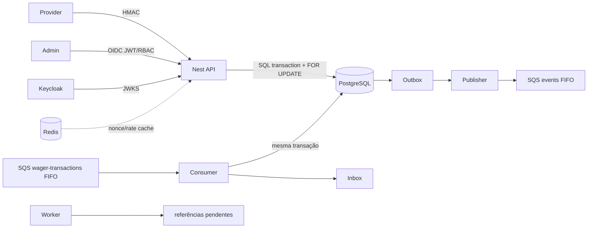

# Arquitetura

O módulo de domínio mantém `Money`, `Wallet`, `WagerTransaction` e validação de ledger. A aplicação (`WagerService`) orquestra a unidade de trabalho. Infraestrutura fornece PostgreSQL, criptografia e SQS. Controllers validam transporte e não implementam regras financeiras.

## Persistência e transações

MikroORM é o ORM adotado. As entidades `WalletEntity` e `WagerTransactionEntity` compõem o Identity Map e a Unit of Work; `Database.transaction()` usa `EntityManager.transactional()`. Criação, leitura, lock e atualização da wallet usam `EntityManager.create`, `persistAndFlush`, `findOne` com `LockMode.PESSIMISTIC_WRITE` e `nativeUpdate` — APIs equivalentes aos padrões usuais de TypeORM. Consultas SQL parametrizadas ficam restritas aos trechos que exigem garantias PostgreSQL específicas: `INSERT ... ON CONFLICT` de idempotência, `FOR UPDATE SKIP LOCKED` de Outbox/reprocessamento e inserção de ledger com checks atômicos. Todas executam no mesmo contexto transacional do `EntityManager`, não numa transação paralela.

`Money` é um Value Object de domínio. Seu componente decimal é persistido como `NUMERIC(20,2)` e a moeda em coluna `CHAR(3)` no mesmo aggregate; a reidratação usa ambos para construir `Money`, evitando a perda de moeda que ocorreria ao mapear um `NUMERIC` isolado. Nenhum caminho converte valores financeiros para `number`.

As migrations SQL ficam em `src/infrastructure/database/migrations`: cada migration ascendente possui uma migration `.down.sql` revisada e `bun run migration:down` reverte a última aplicada.

## Invariantes não negociáveis

| Invariante | Garantia aplicada |
|---|---|
| Dinheiro | `Money`/`Decimal`, strings na borda e `NUMERIC(20,2)` no PostgreSQL; nunca `number`, `float` ou `double`. |
| Idempotência | `UNIQUE(provider_id, idempotency_key)` e hash de payload em PostgreSQL dentro da transação. |
| Uma transação externa | `UNIQUE(provider_id, external_transaction_id)`. |
| Saldo não negativo | `CHECK(balance >= 0)`, lock pessimista por `wallet_id` e atualização/ledger na mesma transação. |
| Ledger imutável | Trigger PostgreSQL rejeita todo `UPDATE` e `DELETE`; `UNIQUE(transaction_id, wallet_id)` e checks aritméticos protegem cada lançamento. |
| Reversão única | `UNIQUE(original_transaction_id)` e `UNIQUE(reversal_transaction_id)`. |
| Mensagens duplicadas | Inbox com `UNIQUE(consumer_name, message_id)`; o ACK do SQS ocorre depois do commit. |
| Publicação | Outbox é escrita na transação financeira; publisher só busca registros já commitados com `FOR UPDATE SKIP LOCKED`. |

Não há cache nem lock global em memória. Redis é apenas rate limit auxiliar e a topologia suporta várias APIs e workers: as decisões financeiras são serializadas por lock de linha e constraints do PostgreSQL, não por processo ou por SQS FIFO.

## Entrada SQS, Inbox e referências pendentes

A fila `wager-transactions.fifo` recebe exclusivamente `WagerTransactionRequested`. O consumer converte o envelope para o mesmo `WagerCommand` usado pela API e chama `executeFromQueue`. O registro de Inbox (`consumer_name`, `message_id`), a transação, saldo, ledger e Outbox são confirmados por uma única `EntityManager.transactional()`; o ACK acontece apenas depois desse commit. Mensagens inválidas ou falhas transitórias não recebem ACK e chegam à DLQ pela redrive policy; rejeições de negócio são respostas normais do caso de uso e são ACKadas.

`PENDING_REFERENCE` tem `reference_attempts` e `next_reference_attempt_at` persistidos. O worker usa `FOR UPDATE SKIP LOCKED`, backoff exponencial limitado a uma hora, TTL de 24 horas e máximo configurável de 20 tentativas. Quando excede um dos limites, o status final é `REJECTED` com `REFERENCE_EXPIRED`.

## Identidade administrativa

Identidade não pertence ao banco da aplicação: Keycloak é o IdP OIDC. `JwtRoleGuard` valida assinatura via JWKS remoto, `iss`, `aud` e as realm roles `ADMIN`, `OPERATOR` e `AUDITOR`. Não existem tabelas locais de usuários, senhas, refresh tokens ou endpoints de login. Health checks permanecem abertos e o consumidor SQS é um canal interno confiável; a identidade de provedor em eventos continua sendo validada pelas regras de domínio.

## Política de referências

WIN e LOSS sem referência são aceitos pelo contrato e não esperam aposta anterior. Quando a referência é enviada, ela deve pertencer ao mesmo provedor, jogador, carteira e moeda e estar processada. REFUND e ROLLBACK exigem referência. Referências ausentes recebem `PENDING_REFERENCE`, são reprocessadas por worker com `FOR UPDATE SKIP LOCKED` e expiram com `REFERENCE_EXPIRED`.

## Reversões

REFUND reverte somente BET e deve ter valor igual. ROLLBACK reverte BET, WIN ou REFUND. A tabela `wager_reversals` impede que a transação original seja revertida duas vezes — inclusive por dois caminhos concorrentes. Rollback que precisaria debitar mais que o saldo é rejeitado como `ROLLBACK_WOULD_NEGATE_BALANCE`.
